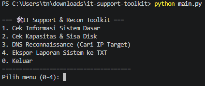

# IT Support & Recon Toolkit

An interactive Command Line Interface (CLI) tool built with Python, designed to automate basic IT Support tasks, system diagnostics, and initial network reconnaissance. 

This project was developed as part of a continuous learning portfolio aimed at building a strong foundation for a career in IT Support and Cybersecurity.

## Key Features

1. **System Information Diagnostics**: Automatically retrieves OS specifications, hardware architecture, and Python version for application compatibility troubleshooting.
2. **Storage Capacity Monitor**: Analyzes total, used, and free disk space (C: Drive) to preemptively identify storage bottlenecks on client machines.
3. **DNS Reconnaissance**: Performs public IP address (IPv4) resolution for target domains using Python's `socket` module.
4. **Automated Report Generation**: Exports diagnostic results into a timestamped `.txt` log file, ideal for helpdesk ticket attachments and audit documentation.

## Installation & Usage

**Prerequisites:** Ensure **Python 3.x** is installed on your system.

1. Clone this repository to your local machine:
   ```bash
   git clone (https://github.com/vexiatitania-ttn/it-support-toolkit.git)

   